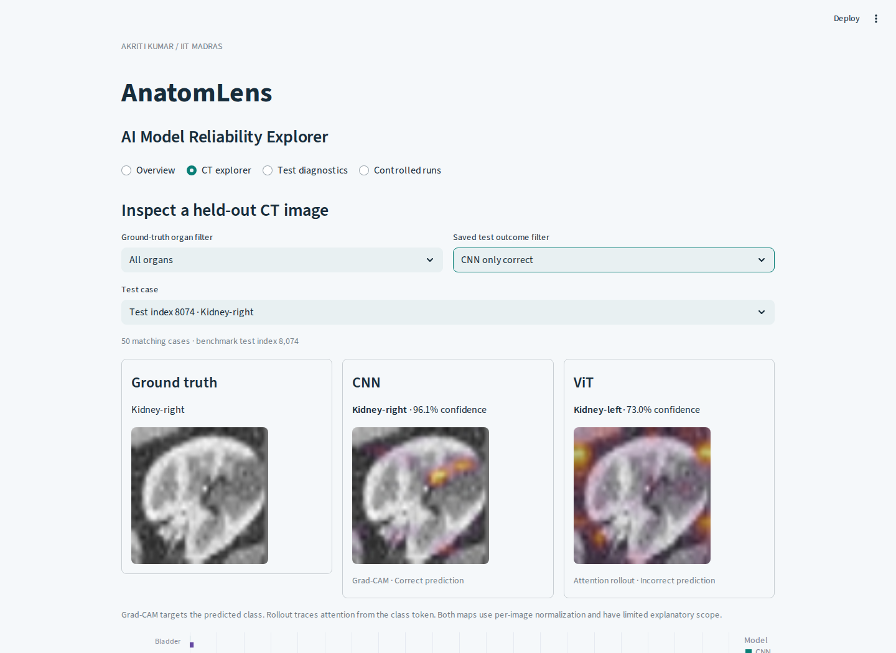

# AnatomLens

**AI Model Reliability Explorer** · Akriti Kumar · BS-MS Dual Degree Biotechnology, IIT Madras

An interactive research demo for Bayosthiti AI’s EdgeChat Wizard campus recruitment. Compare the original trained CNN and small Vision Transformer on held-out OrganAMNIST-64 CT images. Explore predictions, confidence, Grad-CAM, attention rollout, class errors, calibration, and CPU inference time.



[Performance overview](screenshots/overview.png) · [Correct predictions](screenshots/predictions.png) · [Calibration](screenshots/calibration.png)

## Run locally

Use Python 3.11 or 3.12. In WSL or Linux, run:

```bash
python3 -m venv .venv
source .venv/bin/activate
python -m pip install --upgrade pip
python -m pip install torch==2.8.0 --index-url https://download.pytorch.org/whl/cpu
python -m pip install -r requirements.txt
python -m streamlit run app.py
```

Open the local URL printed by Streamlit (usually http://localhost:8501). The included benchmark subset and original model weights support offline use after installing dependencies. On the **CT explorer** tab, filter by true organ or saved test outcome, then pick a case. The app performs fresh inference for each selected case and caches the result during the app session. The bundled subset deliberately includes mistakes and disagreements, so use the full test results for performance estimates.

## Original research results

| Metric | CNN | ViT |
|---|---:|---:|
| Validation accuracy (6,491 cases) | 96.24% | 96.40% |
| Test accuracy (17,778 cases) | 90.16% | 85.59% |
| Trainable parameters | 94,539 | 548,363 |
| Test expected calibration error | 0.020792 | 0.080802 |

The CNN had higher test accuracy and lower test ECE in the original experiments. The CNN used Adam at 0.001, while the ViT used AdamW at 0.0003. Model size and performance therefore describe these particular trained models and protocols. The controlled follow-up is separate. The supplied snapshot contains five completed 20-epoch validation runs and an incomplete ViT seed 2026 run at epoch 8. It supplies no finalized controlled test results.

## Reproduce

```bash
python verify.py
```

The verification command recomputes validation accuracy from the saved validation predictions, test accuracy and 15-bin ECE from saved test probabilities, and confusion matrices from saved labels and predictions. It loads the original weights with strict key matching, counts parameters, compares live outputs to the archived probabilities, and checks spatial map shape and range.

For the full held-out test split, download [OrganAMNIST-64 from MedMNIST’s Zenodo release](https://zenodo.org/records/10519652/files/organamnist_64.npz?download=1) and run:

```bash
python verify.py --dataset /path/to/organamnist_64.npz
ANATOMLENS_DATA=/path/to/organamnist_64.npz python -m streamlit run app.py
```

The full archive must match SHA-256 `7c39150fd57085477a9f0b7f1dcec76eae366f578f4e600653ddc15d46aab6e0`, recorded in the supplied research. `python make_cases.py /path/to/organamnist_64.npz` rebuilds the bundled explorer subset using the original example selection plus up to four cases per organ and test outcome. Inputs are single-channel 64 × 64 images scaled by 255 and normalized using the original training mean (0.4680533955970271) and standard deviation (0.28575827805106974). Class IDs follow the supplied evaluation notebook.

### Provenance

- `models.py` reproduces the architectures from `evaluate_test.py` and the original evaluation setup.
- `checkpoints/cnn.pth` and `checkpoints/vit.pth` contain the unchanged tensors from `best_reproducible_cnn.pth` and `best_small_vit.pth`, repacked as weights-only state dictionaries. Optimizer state and project metadata were omitted.
- `results/original/` contains the selected original evaluation outputs. `results/controlled/` contains only the controlled configuration, summary, and partial history.
- `figures/` contains original evaluation figures.

Dataset credit goes to the [MedMNIST authors](https://medmnist.com/), Yang et al., *MedMNIST v2: A large-scale lightweight benchmark for 2D and 3D biomedical image classification*, Scientific Data 10, 41 (2023), [DOI](https://doi.org/10.1038/s41597-022-01721-8). The explorer ships a small, unmodified subset of the released OrganAMNIST-64 test images and labels with their original indices, under the dataset’s CC BY 4.0 terms.

### Verified in this build

On Linux with PyTorch 2.8.0 CPU and Streamlit 1.52.2, both models matched all 203 bundled classifications. On the full test split, the CNN matched 17,774 of 17,778 archived classifications (maximum probability difference 0.00122). The ViT matched all 17,778 (maximum probability difference 0.00000417). The original tables and filters use the archived predictions. The explorer displays fresh CPU outputs, which can differ slightly from the archived GPU evaluation. Chromium checks covered the case and outcome selectors, both explanations, confusion figures, calibration, efficiency timing, and controlled-run status.

## Scope and contribution

The original DDP experiments, trained checkpoints, and evaluation outputs are Akriti Kumar’s research. The Streamlit interface, integration, and verification scripts were developed with AI assistance. This is a research and education demo using low-resolution benchmark crops. It has no clinical validation. Confidence is a model score, and both explanation methods are qualitative and limited.
